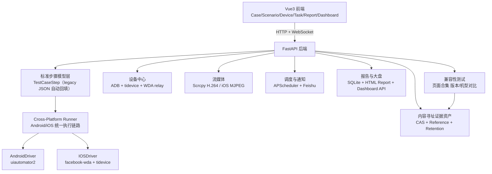

# AutoDroid 项目介绍（深度实现版）

> 适用场景：项目立项介绍、技术方案评审、团队内部培训、对外能力宣讲。

## 1. 项目定位

AutoDroid 是一个低代码 UI 自动化测试平台，核心模式是：

- Android 实时投屏/静态截图录制，iOS WDA MJPEG 预览与静态层级录制
- 统一步骤模型（标准步骤 + 兼容 legacy）
- Android / iOS 双端执行
- 兼容性测试（页面合集版本/机型对比）与可审计证据资产
- 多设备并发、定时调度、报告与通知闭环

它解决的不是“单次脚本执行”，而是把 `录制 -> 编排 -> 预检 -> 执行 -> 报告 -> 运营` 全流程工程化。

## 2. 核心价值

1. 降低自动化门槛：录制与步骤编排可视化，减少对代码能力依赖。  
2. 一套用例覆盖双端：通过跨端步骤模型分发到 Android / iOS。  
3. 执行前风险拦截：预检提前发现平台、定位器、变量、WDA、app 映射问题。  
4. 运行稳定性提升：设备状态治理、WDA relay、执行后状态恢复、失败截图保留。  
5. 可规模化运营：支持多设备并发、定时任务、飞书通知、运行大盘与告警。

## 3. 功能全景（产品能力）

| 业务域 | 功能能力 | 关键实现 |
|---|---|---|
| 用例管理 | 用例 CRUD、复制、目录树组织、标签、变量 | `backend/api/cases.py`、`backend/api/folders.py` |
| 安装包管理 | APK/Ad Hoc IPA 上传、分片上传、版本管理和设备安装 | `backend/api/packages.py` |
| 录制编排 | Android 实时投屏/静态截图录制；iOS WDA 静态截图、元素审查、交互录制、步骤编辑与单步执行 | `backend/main.py` `/device/*` + `frontend/src/components/DeviceStage.vue` `StepBuilder.vue` |
| 跨端执行 | 标准步骤下发 Android/iOS，容错策略控制流程 | `backend/drivers/cross_platform_runner.py`、`android_driver.py`、`ios_driver.py` |
| 场景编排 | 多用例串联、别名、变量上下文跨用例传递 | `backend/api/scenarios.py` |
| 并发运行 | 场景多设备并发批次执行，设备级预检过滤 | `backend/api/scenarios.py` `_schedule_concurrent_runs` |
| 调度中心 | DAILY/WEEKLY/INTERVAL/ONCE 定时策略，支持 UI 场景与 Fastbot 任务 | `backend/scheduler_service.py`、`backend/api/tasks.py` |
| 设备中心 | ADB+tidevice 一键同步、解锁、重启、截图、WDA 检测、iOS 一键无线（WiFi 直连 WDA） | `backend/api/devices.py` |
| 流媒体 | Scrcpy H.264 WebSocket 推流、触控转发、多客户端广播 | `backend/device_stream/manager.py` |
| 报告中心 | 执行列表、详情、下载，DB 数据兜底生成 HTML 报告 | `backend/api/reports.py`、`backend/report_generator.py` |
| 运行大盘 | KPI、趋势、状态分布、失败 Top、告警、即将执行任务 | `backend/api/reports.py` `/api/reports/dashboard/overview` |
| 稳定性探索 | Fastbot 智能探索、性能曲线、Crash/ANR 统计 | `backend/api/fastbot.py`、`backend/fastbot_runner.py` |
| 兼容性测试 | 页面合集的版本对比/机型对比，升级兼容与干净安装两种执行模式 | `backend/api/compatibility.py` |
| 证据资产 | 内容寻址、引用计数、鉴权读取、分层保留和容量水位 | `backend/artifact_store.py`、`backend/api/assets.py` |
| 接口自动化 | 接口库与版本、cURL/文档导入、顺序场景与步骤引用、调试会话、断言与报告、无设备定时执行、影响面与批量同步、可选 AI 校验建议 | `backend/api/api_testing.py`、`backend/api_testing/` |
| AI 能力 | 自然语言生成步骤（NL2Step）、日志 AI 根因分析、接口校验建议与失败解释 | `backend/api/ai.py`、`backend/api/log_analysis.py`、`backend/api_testing/ai_service.py` |
| 配置与通知 | 系统配置中心、飞书测试报告卡片通知 | `backend/api/settings.py`、`backend/notification_service.py` |
| 移动端适配 | 自动/PC/移动模式切换，提供概览、设备、用例/场景执行和报告查看 | `frontend/src/composables/useClientMode.js`、`frontend/src/layout/Index.vue` |

## 4. 技术架构概览

### 技术栈

- 前端：Vue 3 + Element Plus + Vite + Pinia + ECharts  
- 后端：FastAPI + SQLModel (SQLite) + APScheduler  
- Android 自动化：uiautomator2 + ADB  
- iOS 自动化：facebook-wda + tidevice  
- 图像/OCR：OpenCV + PaddleOCR（兼容封装）  
- 实时通信：WebSocket（执行日志、Scrcpy H.264、WDA MJPEG）

### 移动端架构与边界

前端通过 `useClientMode` 提供 `auto / pc / mobile` 三种模式：

- 自动模式在视口宽度不超过 `768px` 或检测到触控型指针时启用移动布局。
- 用户可在登录页、桌面导航栏或移动端页头手动切换模式，选择结果写入 `localStorage`。
- 移动端使用独立页头和底部导航，主入口为概览、设备、用例、场景和报告。
- 路由通过 `meta.mobileAvailable` 声明移动端可用性；未开放的页面统一展示 PC 模式提示。

当前移动端聚焦查看和轻量执行：支持设备状态与常用运维、用例/场景发起执行，以及 UI 报告列表与详情查看；用例编辑、复杂场景编排、资产配置、调度和系统管理仍使用 PC 模式。

## 5. 核心实现机制（深度）

### 5.1 统一执行链路与 Feature Flags

执行统一走标准跨端链路 `backend/drivers/cross_platform_runner.py`（原 legacy `backend/runner.py` 已删除，`cross_platform_runner` 开关随之移除）。执行必须显式指定设备。

Feature Flags（`backend/feature_flags.py`，默认值在代码内 `_FLAG_DEFAULTS`，`SystemSetting` 可覆盖）：

| 开关 | 默认值 | 说明 |
|---|---:|---|
| `new_step_model` | 开 | 标准步骤模型读写，DB 显式 `false` 可临时回退 |
| `ios_execution` | 关 | 允许 iOS 执行 |
| `ws_disconnect_abort` | 关 | 用例执行 WebSocket 断开即中止 |
| `content_addressed_assets` | 关 | 内容寻址证据双写 |
| `tiered_asset_retention` | 关 | HOT/WARM/PINNED/COLD 分层保留，依赖资产双写 |

设置 API 和前端会共同约束父子依赖；关闭父功能会同步关闭子开关。

存量 `TestCase.steps`（legacy JSON）会在每次启动时幂等回填到 `TestCaseStep` 标准表（`backend/database.py::backfill_case_steps_to_standard`，单条失败跳过不阻塞启动）。

### 5.2 标准步骤模型与 legacy 兼容迁移

标准步骤实体：`backend/models.py::TestCaseStep`，核心字段：

- `action`、`args`、`timeout`、`error_strategy`
- `execute_on`（平台允许列表）
- `platform_overrides`（平台定位器覆盖）

兼容策略：

- 存量 `TestCase.steps`（legacy JSON）继续保留
- 标准表优先读取；缺失时可从 legacy 自动构建
- 前端保存时“双写”：先保存 legacy，再尝试 `PUT /cases/{id}/steps` 落标准步骤
- 标准保存失败时前端会告警并保留兼容数据

核心文件：

- `backend/step_contract.py`（标准/legacy 双向转换）
- `backend/api/cases.py`（双写与同步逻辑）
- `frontend/src/stores/useCaseStore.js`（前端保存/加载兼容策略）

### 5.3 跨端定位解析与动作分发

定位解析由 `backend/locator_resolution.py` 统一处理：

- 优先平台显式覆盖 `platform_overrides.{platform}`
- 回退 Android 定位
- iOS 支持从 Android `text/description` 自动推导 `label/name` 候选

动作分发由 `CrossPlatformRunner._dispatch` 完成，统一支持：

- `click`、`input`、`wait_until_exists`
- `assert_text`、`assert_image`
- `click_image`、`extract_by_ocr`
- `sleep`、`swipe`、`back`、`home`
- `start_app`、`stop_app`

并内置定位候选 fallback、OCR 提取重试、失败截图采集。

更完整的动作矩阵、参数规则与平台差异见：`docs/EXECUTION_SPEC.md`。

### 5.4 变量流转机制

变量来源：

- 环境变量（`Environment` / `GlobalVariable`）
- 用例变量（`TestCase.variables`）
- 运行时导出变量（如 `extract_by_ocr` 的 `output_var`）

渲染规则：

- 占位符格式 `{{KEY}}`，由 `backend/utils/variable_render.py` 渲染
- 未命中变量不会硬替换，预检可拦截未解析占位符

场景执行时，前序用例导出的变量会写入场景上下文并传给后续用例。

### 5.5 容错策略（error_strategy）语义

- `ABORT`（默认）：步骤失败立即终止，用例 / 场景判 `FAIL`
- `CONTINUE`：标记失败但继续后续步骤 / 用例，用例 / 场景仍判 `FAIL`
- `IGNORE`：失败记为**跳过**（`skip_reason=失败已忽略：<原文>`，错误详情与截图仍保留），**不影响用例 / 场景结论**（判 `PASS`）

总原则：结论只由未被容忍的失败决定，被容忍的异常只影响步骤行显示。用例所有步骤均为跳过时归类 `WARNING` / `skipped`（表示未真正验证到内容）。详见 `docs/EXECUTION_SPEC.md` §2.2。

该语义在跨端执行链路中统一实现（云端 backend、桌面 engine、AutoJs6 设备端运行时）。

### 5.6 预检体系与错误码

预检核心在 `backend/cross_platform_execution.py`，覆盖：

- 平台允许运行校验（`execute_on`）
- 平台动作支持校验
- 定位器完整性校验
- 参数结构校验
- 未解析变量占位符校验
- `app_key` 到平台 app_id 映射校验
- iOS WDA 健康校验

关键错误码：

- `P1001_PLATFORM_NOT_ALLOWED`
- `P1002_ACTION_NOT_SUPPORTED`
- `P1003_SELECTOR_MISSING`
- `P1004_APP_MAPPING_MISSING`
- `P1005_WDA_UNAVAILABLE`
- `P1006_INVALID_ARGS`
- `S1001_SCENARIO_PRECHECK_FAILED`
- `P2002_ADB_ANDROID_ONLY`
- `P3001_FASTBOT_ANDROID_ONLY`
- `P3002_WDA_IOS_ONLY`
- `P3003~P3008_WIRELESS_*`（iOS 无线模式相关，见 `docs/IOS_WDA_OPS.md` §3.5）

### 5.7 场景级预检与设备过滤

场景执行前，系统会逐设备预检所有用例：

- 前端先预检，过滤明显不可执行设备
- 后端 `run_scenario_api` 再次预检并返回 `blocked_prechecks`
- 如果所选设备全部被拦截，返回 `S1001_SCENARIO_PRECHECK_FAILED`

该设计避免“任务已启动但全部秒失败”的无效执行。

## 6. 平台能力矩阵与边界

| 能力 | Android | iOS | 说明 |
|---|---|---|---|
| 静态截图录制（`/device/dump/inspect/interact/execute_step`） | 支持 | 支持 | iOS 通过 WDA 获取截图、层级并执行交互 |
| 实时投屏录制 | 支持 | 不支持 | Scrcpy 实时流仅支持 Android |
| 用例执行 | 支持 | 支持（需开 `ios_execution` 且 WDA 健康） | 跨端 Runner 统一调度 |
| 场景并发执行 | 支持 | 支持 | 设备级预检过滤 |
| 实时设备画面 | Scrcpy 可交互 | WDA MJPEG 只读预览 | iOS 点击/框选仍使用静态截图和层级 |
| Fastbot 探索 | 支持 | 不支持 | `P3001_FASTBOT_ANDROID_ONLY` |
| 兼容性测试（页面合集对比） | 支持 | 不支持 | 页面合集采集截图与 UI XML 做版本/机型对比 |
| WDA 检测 | 不适用 | 支持 | `POST /devices/{serial}/wda/check` |
| 无线连接（免数据线） | 手动支持（无线 adb，见 `docs/ANDROID_WIRELESS_ADB.md`） | 支持（一键） | iOS 一键启用 WiFi 直连 WDA，`POST /devices/{serial}/wireless/enable`，详见 `docs/IOS_WDA_OPS.md` §3.5 |

结论：当前产品形态是“Android 实时/静态录制 + iOS MJPEG 预览/静态层级录制 + Android/iOS 标准执行 + Android 兼容性测试”。

## 7. 设备管理与稳定性保障

### 7.1 设备中心

`backend/api/devices.py` 提供：

- 一键同步：Android（ADB）+ iOS（tidevice）合并入库
- 设备状态：`IDLE / BUSY / OFFLINE / WDA_DOWN`
- 设备命名、截图、解锁、重启

### 7.2 iOS WDA 管理

WDA URL 解析优先级：

1. `ios_wda_url.{serial}`
2. `ios_wda_url_map`
3. `ios_wda_url`
4. 自动本地 relay

WDA relay 由 `backend/wda_port_manager.py` 管理，端口范围 `8200-8299`，支持多设备并发隔离。

### 7.3 执行后状态恢复

执行完成后调用 `restore_device_status_after_execution`：

- Android 一般恢复 `IDLE`
- iOS 会复查 WDA 健康，失败则标记 `WDA_DOWN`

### 7.4 强制解锁与执行中止

`POST /devices/{serial}/unlock` 会：

- 触发 Python 侧中止事件（终止运行中的 Runner）
- Android 侧清理残留进程（Fastbot/Monkey/uiautomator2）
- 回收设备状态，降低“设备卡 BUSY”概率

## 8. Android Scrcpy 与 iOS MJPEG

Android 使用 Scrcpy H.264 实时画面和触控转发。iOS 使用 WDA MJPEG 提供近实时只读预览；元素审查、点击、框选和步骤录制仍在静态截图与页面层级上完成，确保交互坐标和定位器一致。

设备流管理器 `backend/device_stream/manager.py` 负责：

- USB 设备热插拔监听（`adbutils.track_devices`）
- 自动部署 `scrcpy-server.jar`
- H.264 帧读取与 WebSocket 广播
- 触控事件转发
- 新客户端连接时下发缓存 `SPS/PPS`

API/WS：

- `GET /devices`、`GET /devices/{serial}`
- `POST /devices/{serial}/touch`
- `WS /ws/scrcpy/{serial}`

iOS MJPEG 由独立 relay 管理，设备端默认端口 `9100`，本地 relay 使用 `9300-9399`：

- `WS /ws/ios-mjpeg/{serial}`：完整 JPEG 二进制帧。
- `GET /api/stream/ios-mjpeg/{serial}`：multipart 流。
- `ios_mjpeg_port/framerate/quality`：全局或设备级 `SystemSetting`。

详细启动、无线直连和故障处理见 `docs/IOS_WDA_OPS.md`。

## 9. 调度、通知与可观测性闭环

### 9.1 定时调度

调度服务 `backend/scheduler_service.py` 支持：

- `DAILY` / `WEEKLY` / `INTERVAL` / `ONCE`

任务中心 `backend/api/tasks.py` 支持三类任务：

- UI 场景任务（执行前预检过滤设备）
- Fastbot 任务（稳定性探索）

任务配置通过 `strategy_config` 承载扩展字段（如 `_task_type`、`env_id`、Fastbot 参数）。

### 9.2 通知服务

`backend/notification_service.py` 提供：

- UI 执行结果飞书卡片（通过率、失败摘要、设备结果、报告链接）
- Fastbot 报告飞书卡片（Crash/ANR/CPU/Mem 概览）

### 9.3 报告与大盘

报告中心：

- 执行列表：`GET /api/reports/executions`
- 执行详情：`GET /api/reports/executions/{id}`
- 下载报告：`GET /api/reports/executions/{id}/download`（支持 DB 回填生成 HTML）
- 报告静态资源：`GET /api/report-assets/{path}`
- 兼容性报告：`GET /api/compatibility/runs`
- 内容寻址资产：`GET /api/assets/status`、`GET /api/assets/{asset_id}`（仅鉴权 canonical API）

Dashboard（`GET /api/reports/dashboard/overview`）输出：

- KPI：执行总量、通过率、失败场景数、平均耗时、运行中执行、空闲设备、启用任务
- 趋势：24h / 7d / 30d
- 状态分布：PASS/WARNING/FAIL/ERROR/RUNNING
- 失败场景 Top
- 告警：连续失败、设备离线、WDA_DOWN、任务异常
- 即将执行任务

## 10. Fastbot 稳定性探索专项

### 10.1 任务管理

`backend/api/fastbot.py` 提供：

- 任务创建、查询、删除
- 报告查询
- Android 设备列表（实时在线状态）
- 设备内存锁（避免同设备并发冲突）

### 10.2 执行引擎

`backend/fastbot_runner.py` 实现：

- 首次自动推送 Fastbot 资源到设备
- Monkey 命令构造（支持事件权重）
- 性能采集协程（CPU/Mem）
- Logcat 监控协程（Crash/ANR 去重）
- 可选“崩溃即停”
- 汇总 `avg/max CPU`、`avg/max Mem`、`total_crashes`、`total_anrs`

## 11. 兼容性测试

兼容性测试只保留「页面合集」一条链路：先在页面合集中手动维护预设页面（页面名称、进入页面用例、稳定等待时间与必需文本），再新建对比任务，按页面采集截图与 UI XML 后逐页比对。

- 对比维度：版本对比、机型对比（指定基准设备横向比对）。
- 执行模式：升级兼容（先安装旧包采集基线，再覆盖安装新包且不清数据）、干净安装（分别清理安装旧包和新包，适合纯视觉回归）。
- 旧版 APK 可选「当前版本」，不强制上传旧包。
- 判定阈值：像素差异比例、结构相似度（SSIM）、XML 差异比例；截图尺寸变化、Crash/ANR 与必需文本缺失一并纳入结果。视觉或结构差异默认计为警告，安装失败、页面不可达、Crash/ANR、必需文本缺失判为失败。

发起任务时会把页面合集名称和页面列表复制进兼容性任务快照，后续编辑或删除页面合集不会影响历史报告展示。

长任务通过 `backend/device_execution_lease.py` 同时持有内存限流租约和 DB owner 租约；释放时只有原 owner 可以恢复设备状态，避免并发任务互相解锁。

证据在 `content_addressed_assets` 开启时双写到 `asset_store/`。`StoredAsset` 按内容哈希去重，`AssetReference` 按 owner/role 管理 HOT、WARM、PINNED、COLD 保留。

## 12. 接口自动化

面向"初级测试也能维护"的低代码接口测试：接口库 + 顺序场景 + 点选式断言，独立于设备执行。

### 12.1 能力与入口

| 能力 | 说明 | 关键实现 |
|---|---|---|
| 接口库 | 目录、版本、样例、复制、搜索；接口被场景引用时禁止删除并列出引用者 | `backend/api/api_testing.py` |
| 录入 | 粘贴 cURL、导入 OpenAPI 3 / Swagger 2.0 / Postman v2.1（JSON/YAML，只解析不发送，只创建勾选项） | `backend/api_testing/curl.py`、`specs.py` |
| 场景编排 | 步骤引用前序输出、等待步骤、拖拽排序、步骤级局部覆盖与失败重试 | `frontend/src/views/api-testing/ScenarioEditor.vue` |
| 调试 | 隔离的调试会话：单步、从头执行到此步、不重发请求的"重新校验响应" | `backend/api_testing/service.py` |
| 断言 | 字段 + 条件 + 期望值；类型严格；零断言记为 `UNCHECKED` 而非通过 | `backend/api_testing/values.py` |
| 执行与报告 | 无设备顺序执行、冻结配置快照、HTML 报告导出、飞书摘要通知、独立定时任务 | `backend/api_testing/reporting.py`、`notification_service.py` |
| 影响面 | 接口变更后列出引用它的场景与步骤，无冲突步骤一键批量同步 | `GET /interfaces/{id}/usages`、`POST /interfaces/{id}/sync-apply` |
| AI 辅助（可选） | 校验建议与失败解释；证据受限、只进草稿、默认关闭 | `backend/api_testing/ai_service.py` |

### 12.2 三个关键设计

- **标签化值模型**：所有输入都是 `literal / env / ref / template / object / array` 之一，用户 JSON 不会被当成表达式执行；只有 `literal` 字符串支持 `{{ENV}}` 替换，对象与数组必须走结构化值（`backend/api_testing/schemas.py`）。
- **接口模板 + 步骤覆盖**：场景步骤保存接口快照，本步骤的修改以整字段覆盖记录；接口更新后按差异逐项确认，不静默覆盖用户改动。
- **执行语义保守**：真实请求、不做业务回滚、不自动重试；步骤级重试只覆盖"请求未到达服务端"的连接层失败，读超时与已收到响应一律不重试，避免重复写入。

### 12.3 校验与判定

预检分保存 / 调试 / 运行三档，错误带步骤、输入位置与分类；断言求值类型严格（`1` 与 `"1"` 不相等，大小比较拒绝隐式转换）；响应字段树最多 2000 节点、32 层，响应体上限 5 MiB，超限失败不解析截断数据。

### 12.4 边界

单后端进程内最多 4 个并发执行工作线程，其余排队；调试上下文与 AI 调用缓存不跨进程共享，因此不为该模块单独增加 Uvicorn worker。报告按团队要求明文展示请求与响应（含解析后的凭证），报告读取仅要求登录。

## 13. AI 能力

### 13.1 NL2Step（自然语言生成步骤）

`backend/api/ai.py`：

- 通过严格 Prompt 约束输出标准步骤 JSON
- 支持输出清洗、结构归一化、动作/参数校验
- LLM 不可用时自动 fallback 到模板步骤

前端入口：`StepBuilder.vue` 的 “AI 智能生成测试步骤”。

### 13.2 日志 AI 根因分析

`backend/api/log_analysis.py`：

- 先做日志清洗降噪（抽取关键堆栈）
- 对清洗结果做 MD5 缓存，减少重复调用
- 调用 OpenAI 兼容接口返回 Markdown 诊断结果

前端入口：`FastbotReportDetail.vue` 的日志弹窗中“一键 AI 分析”。

## 14. 端到端典型流程

### 14.1 用例流（录制 -> 执行 -> 报告）

1. 设备中心同步 Android 或 iOS 设备。
2. 用例编辑页选择设备；Android 可使用实时投屏或静态截图，iOS 使用 WDA 静态截图，通过 `/device/interact` 录制生成步骤。
3. `StepBuilder` 补充动作参数、容错策略、OCR/图像步骤。  
4. 保存时 legacy 与标准步骤双轨持久化。  
5. 运行前执行 `precheck`，拦截不可执行步骤。  
6. 通过 WebSocket 或后台任务执行。  
7. 生成 HTML 报告并在报告中心查看。  

### 14.2 场景流（编排 -> 多设备并发）

1. 场景中按顺序编排多个用例。  
2. 每台目标设备先做场景预检。  
3. 可执行设备进入并发批次，失败设备写入 `blocked_prechecks`。  
4. 运行中保留步骤级结果与截图，完成后聚合场景报告。  

### 14.3 定时流（任务 -> 通知）

1. 任务中心配置调度策略与设备。  
2. 到点由 APScheduler 触发。  
3. UI 任务先做预检过滤，再执行批次。  
4. 执行完成后自动发送飞书卡片通知。  

### 14.4 兼容性流（页面合集 -> 对比 -> 报告）

1. 在「页面合集」中维护预设页面：页面名称、进入页面用例、稳定等待时间和必需文本。
2. 新建对比任务，选择对比维度（版本对比/机型对比）、执行模式（升级兼容/干净安装）、旧版与新版 APK（旧版可选「当前版本」）、Android 设备和判定阈值。
3. 任务把页面合集名称和页面列表复制进快照，按页面采集截图与 UI XML。
4. 逐页计算像素差异、SSIM 与 XML 差异并给出判定，报告展示差异图以及 Crash/ANR、必需文本缺失等结论。

## 15. 数据模型（核心表）

| 表 | 作用 |
|---|---|
| `TestCase` | 用例主体（含 legacy 步骤、变量、标签、最近运行状态） |
| `TestCaseStep` | 标准跨端步骤模型（执行主数据） |
| `TestScenario` / `ScenarioStep` | 场景与用例编排关系 |
| `TestExecution` / `TestResult` | 执行记录与步骤结果 |
| `Device` | 设备资产与实时状态 |
| `ScheduledTask` | 定时任务配置 |
| `FastbotTask` / `FastbotReport` | Fastbot 任务与报告 |
| `CompatibilityRun` / `CompatibilityCell` / `CompatibilityPageResult` | 兼容性任务、设备单元和页面结果 |
| `StoredAsset` / `AssetReference` | 不可变内容寻址资产与 owner 引用 |
| `ApiFolder` / `ApiDefinition` / `ApiScenario` / `ApiScenarioStep` | 接口目录、接口定义（含版本与样例）、接口场景与步骤快照 |
| `ApiRun` / `ApiStepResult` | 接口运行记录与逐步结果（冻结配置快照） |
| `Environment` / `GlobalVariable` | 环境变量库 |
| `AppPackage` | 安装包资产 |
| `SystemSetting` | 全局配置与 Feature Flag 存储 |

## 16. 安全与权限机制

- 认证：OAuth2 Password + JWT（Bearer）  
- 鉴权：通过依赖注入校验当前用户  
- 角色：支持 `admin/user`（用户管理接口受角色限制）  
- 前端拦截：`401` 自动清理 token 并跳转登录  
- 资产读取：CAS 只提供 `/api/assets/*` 鉴权端点，不提供匿名 legacy alias

> 生产部署建议：替换默认密钥与默认管理员初始密码，开启 HTTPS 与最小权限策略。

## 17. 发布与运维建议（灰度顺序）

建议按以下顺序灰度上线：

1. `new_step_model` 默认开启，legacy 步骤在启动时自动回填标准表；如需临时回退可在 `SystemSetting` 显式写 `false`。  
2. 跨端 Runner 已是唯一执行链路（原 `cross_platform_runner` 开关已移除），关注执行必须选择设备的交互变化。  
3. 开启 `ios_execution`：WDA 运维稳定后逐步引入 iOS 执行。  
4. 开启 `content_addressed_assets`：双写、回填、核对 `/api/assets/status` 后再开启 `tiered_asset_retention`。

配套监控建议：

- 场景预检拦截率（特别是 `P1003/P1004/P1005`）
- `WDA_DOWN` 设备占比与恢复时长
- 任务逾期未触发数量
- 连续失败场景 Top
- 资产水位、PINNED 字节数、可回收字节数和 507 拒绝次数

## 18. 项目边界与当前形态总结

- 当前明确定位：`Android 实时/静态录制 + iOS MJPEG 预览/静态层级录制 + Android/iOS 执行`。
- iOS MJPEG 是只读预览；录制与定位仍依赖 WDA 静态截图和层级。
- Fastbot 仅 Android 支持。  
- 兼容性测试仅支持 Android APK 的版本/机型对比，按页面合集采集截图与 UI XML。
- 跨端能力依赖标准步骤模型与预检，建议将预检作为运行前必经流程。  

---

## 附：关键代码入口（便于技术评审快速定位）

- 后端入口：`backend/main.py`  
- 跨端执行核心：`backend/cross_platform_execution.py`  
- 跨端 Runner：`backend/drivers/cross_platform_runner.py`  
- 标准步骤契约：`backend/step_contract.py`  
- 用例/场景 API：`backend/api/cases.py`、`backend/api/scenarios.py`  
- 设备中心：`backend/api/devices.py`  
- 调度任务：`backend/api/tasks.py`、`backend/scheduler_service.py`  
- 通知服务：`backend/notification_service.py`  
- 报告与大盘：`backend/api/reports.py`  
- Fastbot：`backend/api/fastbot.py`、`backend/fastbot_runner.py`  
- 兼容性测试：`backend/api/compatibility.py`
- 证据资产与保留：`backend/artifact_store.py`、`backend/api/assets.py`、`backend/retention_service.py`
- 设备长任务租约：`backend/device_execution_lease.py`
- 接口自动化：`backend/api/api_testing.py`、`backend/api_testing/`（引擎/调试会话/导入/AI）、`frontend/src/views/api-testing/`
- AI：`backend/api/ai.py`、`backend/api/log_analysis.py`  
- 前端核心：`frontend/src/components/DeviceStage.vue`、`StepBuilder.vue`、`LogConsole.vue`、`frontend/src/views/*`  
