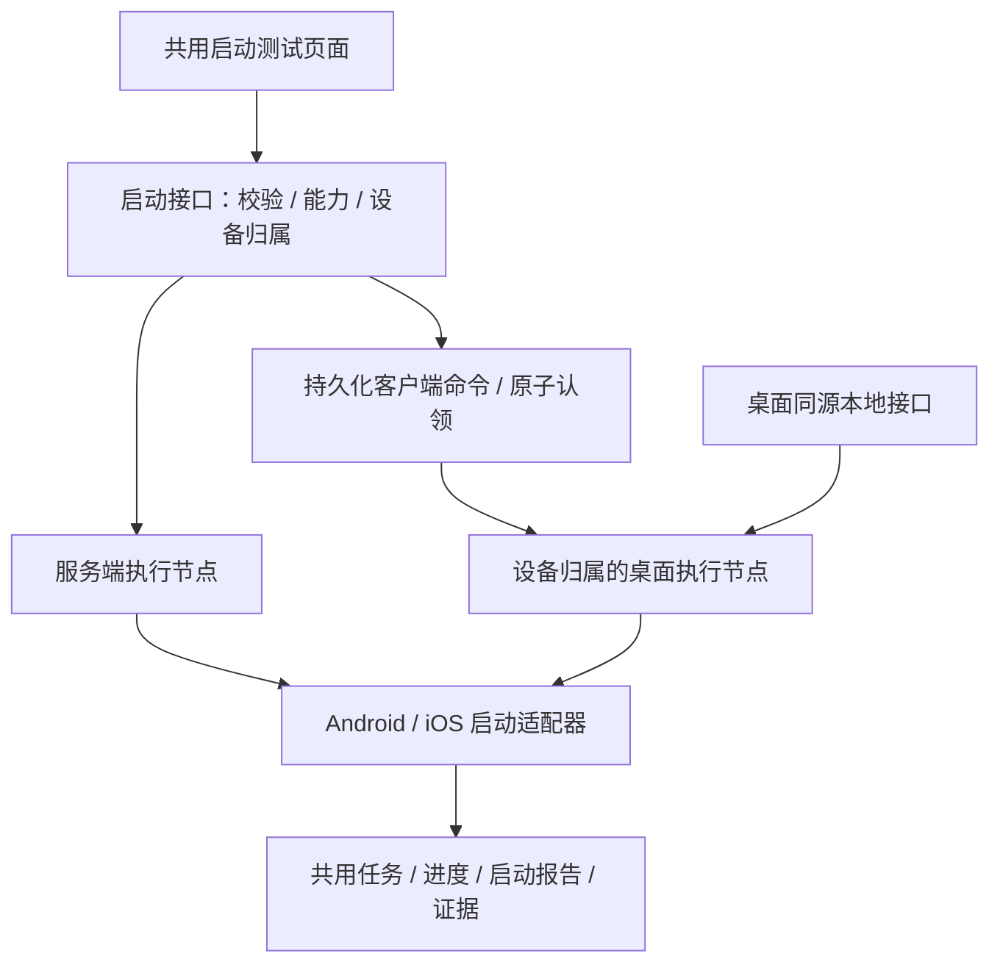

# 冷热启动测试实施计划：桌面客户端、iOS 与 Web

日期：2026-11-16。本文为基于当前代码的实施计划，尚未修改业务实现。

## 1. 目标与范围

在现有「冷热启动」专项中，补齐桌面本地执行，增加 iOS 真机支持，并使桌面与平台 Web 共用配置、任务状态和报告。

本文中的 Web 指 AutoDroid 管理平台入口。测试对象为 Android/iOS App；网页导航、浏览器缓存冷暖启动及 Electron 自身启动性能需要独立定义指标，不纳入本轮。

| 发起入口 | 设备位置 | 目标能力 |
| --- | --- | --- |
| 桌面客户端 | 本机 Android | 本地冷启动、热恢复、就绪检查、进度、取消、结果上报 |
| 桌面客户端 | 本机 iOS | 通过 WDA 完成冷启动、后台恢复、就绪检查、进度、取消、结果上报 |
| 平台 Web | 服务端可控制的 Android/iOS | 由服务端对应平台执行器执行；iOS 要求 WDA 健康且相关能力可用 |
| 平台 Web | 在线桌面客户端连接的 Android/iOS | 派发到设备归属的客户端执行，回传相同报告 |

Android 覆盖现有 macOS/Windows 桌面运行环境。iOS 首批以 macOS + 已可运行 WDA 的真机验收；Windows iOS 接入按实际工具链和 WDA 可达性开放，不承诺 Windows 上完成首次 WDA 构建或自动修复。

## 2. 已有能力与实际缺口

| 现状 | 代码位置 | 对实施的影响 |
| --- | --- | --- |
| Web 已有 Android 启动采集、首页就绪检查与慢启动 Perfetto 诊断 | `backend/fastbot/startup.py` | 复用算法和报告语义，拆除与运行环境耦合的依赖 |
| 桌面模式显式禁止提交，设备列表只允许 Android | `frontend/src/views/special/Startup.vue` | 改为按平台、设备归属和执行节点能力开放 |
| 服务端启动接口强制 Android，并检查服务端 ADB 在线清单 | `backend/api/fastbot.py::run_startup_test` | 必须增加平台执行器与执行节点路由，删除前端门控不足以完成支持 |
| 桌面只拦截普通 Fastbot，没有启动专项本地 POST 路由 | `../AutoDroid-Desktop/engine/local_api.py` | 补本地启动路由，禁止把本机设备误交给服务器 ADB |
| 云端已支持 `kind=startup`、`run_id` 幂等、报告归类和产物上传 | `backend/api/client_fastbot.py`、`../AutoDroid-Desktop/engine/core/cloud_bridge.py` | 继续沿用同一任务和报告系统 |
| 桌面已有 iOS 应用状态、launch、activate、terminate、Home 操作及 WDA 常驻资源 | `../AutoDroid-Desktop/engine/core/fastbot_ios/wda.py`、`engine/core/ios_device.py` | 复用生命周期管理，不再为启动测试创建第二套 WDA 管理器 |
| 现有 `/api/client-tasks` 只下发定时 UI 场景 | `backend/api/tasks.py`、`../AutoDroid-Desktop/engine/core/task_scheduler.py` | Web 即时派发需要新的持久化命令链路 |
| 客户端收尾仅接受 COMPLETED/FAILED，缺启动专项进度与可靠补传 | `backend/api/client_fastbot.py` | 补取消状态、进度、心跳及中断收尾 |
| 就绪超时仍可能记为 PASS，部分页面把 null 转为 0 ms | `backend/fastbot/startup.py::_run_single_startup_iteration`、`Startup.vue::formatMs` | 本轮统一修正统计与展示，防止产生误导结果 |

## 3. 先统一测量口径

### 3.1 冷启动与热启动

- **冷启动**：停止目标 App，确认进程不在运行后，开始计时并启动。保留 App 数据；首次安装、清数据和重启设备后的启动属于不同场景。
- **热启动/后台恢复**：预先启动目标 App，完成准备状态，回到 Home；确认 App 仍在后台或挂起，再开始计时并恢复前台。准备、固定等待和设备工具初始化均不计入正式样本。
- 记录 `requested_mode`、实际前后状态、可获取的进程标识、`sample_valid` 和无效原因。Android 优先利用 LaunchState 等证据识别 Activity 重建；iOS 恢复前若进程已退出，则该轮不能纳入热恢复统计。无法确认时标为状态未验证，不伪造确定分类。

### 3.2 指标分层

| 指标 | Android | iOS | 展示规则 |
| --- | --- | --- | --- |
| 平台原生启动指标 | 保留 `am start -W` 的 ThisTime/TotalTime/WaitTime，及实际可获取的 Displayed/Fully drawn | 首期不填 Android 同名指标 | 保留原始来源，不把控制请求耗时换名为系统首帧耗时 |
| 自动化启动/恢复耗时 | 主机发起命令至返回或确认前台 | WDA 发起 launch/activate 至返回并确认前台 | 单独命名，说明包含控制链路开销 |
| 业务就绪耗时 `ready_ms` | 从发起启动/恢复至目标元素满足条件 | 同左，通过 WDA locator 检查 | 仅在启用就绪检查且命中时有值；包含自动化查询与采样开销 |
| 系统首帧/响应指标 | 仅展示有可靠平台证据的值 | 后续可评估独立 XCTest 性能测试与 `XCTApplicationLaunchMetric` | 作为后续增强，不阻塞首期 WDA 能力 |

正式计时前完成 ADB/U2/WDA 连接、会话初始化及预检。固定并记录 WDA 的等待策略、查询周期和超时；退出时恢复被临时调整的配置。不能通过减去固定延迟来推算系统首帧。

iOS `activate()` 可能在 App 未运行时自动启动，WDA 的 launch 也可能对正在运行的 App 执行激活，因此必须检查实际状态。WDA 请求耗时与 XCTest 系统测量分别来自不同边界，报告需明确区分。[Apple activate()](https://developer.apple.com/documentation/xcuiautomation/xcuiapplication/activate())、[XCTApplicationLaunchMetric](https://developer.apple.com/documentation/xctest/xctapplicationlaunchmetric)。

Android 的冷、温、热状态和 TTID/TTFD 也不同；现有 ADB 字段及业务元素就绪不能统一标为 TTFD。[Android App startup time](https://developer.android.com/topic/performance/issues/launch-time)。

### 3.3 成功、达标与聚合

- 分开记录启动成功、业务就绪成功、样本有效性和性能是否达标。启用就绪检查后超时，必须显示为就绪失败，不能统计成业务就绪成功。
- 平均值、P50/P90/P95、最小值、最大值按平台、启动模式、指标来源、测量版本分别计算，只使用该指标的有效样本。
- 显示请求轮次、完成轮次、有效样本数、失败数和无效数。快速验证可保留少量轮次；正式比较建议 20–30 轮，少量样本的分位数标注样本不足。
- 阈值独立于 Perfetto 开关，按平台和指标配置；iOS 不直接套用 Android TotalTime 的阈值。不开启就绪检查时，报告不显示就绪达标结论。
- 缺失数据统一显示“未采集/不适用”，数值 0 与 null 分开处理。诊断复跑单独标记，排除正式聚合。

## 4. 实现结构与契约

### 4.1 执行分层

- 保留 `/api/fastbot/startup/run`、`/startup/tasks` 及既有报告入口；桌面本地 POST 由网关接管，列表和报告继续使用平台数据。
- 新增启动专项设备/能力接口（建议 `GET /api/fastbot/startup/devices`），桌面提供本机视图，Web 按实际执行节点返回 Android/iOS。前端改用 `getStartupDevices`，不通过放开通用 Fastbot 设备筛选来间接支持 iOS，避免误开放其他专项。
- 平台后端为启动契约与统计逻辑的来源，建议新增 `backend/startup/` 包，现有 `backend/fastbot/startup.py` 保留兼容入口；桌面按现有 vendor 机制同步到 `engine/core/startup/`，用契约测试防止两仓漂移。安装包运行时不得依赖旁边的 `AutoDroid` 源码目录。
- 将生命周期编排、平台采集和环境服务分开：适配器只负责预检、状态准备、计时、就绪查询和取证；编排负责占用、取消、进度、上报及收尾。
- 服务端 iOS 复用现有 driver/WDA 地址解析，为每台设备确定独立可达的 WDA 地址；桌面复用已有 WDA registry 和设备接入。能力不满足时返回明确原因。

### 4.2 请求、任务和报告

- 保留旧请求的 `package_name`、`activity_name`、`startup_modes` 等字段。iOS 页面把应用标识显示为 Bundle ID，服务端按平台校验；Activity/Perfetto 仅对 Android 开放。
- 一次提交限定同一平台；跨平台对比通过应用映射或两次独立提交完成，避免同一应用标识和 locator 错投。
- 增加平台、测量版本、指标来源、就绪定位能力、执行节点能力等元数据。执行节点由服务器按设备归属确定，不能信任客户端传入的任意实例 ID。
- 保留 `summary.session_type = startup` 和 `startup_config/startup_runs/startup_aggregate`，新增测量字段；历史 Android 报告使用旧解释，不重算覆盖。
- 扩展客户端 create 的配置快照与 progress 接口，finish 支持 ABORTED；完成状态与性能达标分开显示。
- 每轮结果携带请求/实际模式、状态前后值、计时来源、启动结果、ready 状态、错误及证据路径。异常轮次保留，不能静默删除。
- 就绪定位按平台校验：Android 沿用 text/id/description/xpath；iOS 优先 accessibility id、name/label、predicate，XPath 按实际支持情况开放。

### 4.3 Web 到桌面的派发

- 按设备的 `client_instance_id` 和当前归属，将一次请求拆为每设备一个任务，提交前校验权限、实例在线、版本和采集能力。
- 新增请求级幂等键和持久化即时命令记录，关联每设备同一个 task_id/run_id；认领响应返回既有任务标识，桌面直接更新该任务，不能再次调用创建接口生成另一份报告。
- 桌面通过登录态发起短轮询或长轮询，原子认领命令；记录 attempt、执行租约和过期时间。复用实例/心跳基础，不将现有定时 UI 场景接口改造成隐式队列。
- claim、progress、finish 和产物更新校验当前 attempt/claim token，拒绝旧执行者迟到覆盖。中断后的补传必须经过恢复校验，按对应 attempt 保留证据，不覆盖后续执行结果。
- 运行前再次确认设备归属和本机实际连接，取得设备占用；同一设备与用例、场景、Fastbot、启动专项互斥。
- 进度与取消走 task_id/run_id 对应的同一执行记录。重复拉取和网络重试不得重复启动。认领后失联不直接在另一节点重跑，先收敛原执行状态。
- 排队超时、客户端退出、设备断开和取消都要有终态；客户端恢复后可补传已有结果，不自动续跑被中断的计时样本。

### 4.4 可靠执行与慢启动证据

- 统一原子设备占用，修补只检查 BUSY 列表仍可并发进入的窗口；批量提交先预检，登记或占用中途失败要释放已取得资源。
- iOS 采集期间独占被测设备的 WDA 会话，暂停会抢占会话的录制/交互及非必要采样；目标 Bundle ID 不能是当前 WDA Runner，避免停止自动化控制进程本身。
- 接入 `run_registry` 或扩展出的同等专项运行登记；取消能中断等待、ADB 子进程和后续轮次。WDA 阻塞调用采用有界超时，安全结束后再释放设备。
- 本地保存报告、产物和待上传清单，按相同 run_id 重试；不持久化用户凭证。区分“测试结束”和“报告同步中/失败”，上传失败不丢本地结果。
- 云端使用执行心跳/租约处理遗留 RUNNING；客户端重启后中断任务最终进入明确终态，保留已完成轮次。
- Android Perfetto 作为独立增量保留：本地采集并上传，复用服务端分析；诊断重跑与正式轮次分开。iOS 首期提供失败截图、状态与可用日志，隐藏 Perfetto，并记录不可采集原因。

## 5. 分阶段工作清单

以下为初步工作量，按仓库现状估算，iOS 真机验证和派发方案确认后校准。

| 阶段 | 工作与交付 | 主要文件 | 估算 |
| --- | --- | --- | --- |
| P0：契约与验证 | 固定冷热定义、计时边界、能力矩阵、版本兼容；用真机验证 iOS WDA 状态/恢复/ready，确认适配接口 | `backend/schemas.py`、`backend/fastbot/startup.py`；新增启动契约/统计模块 | 1–2 人日 |
| P1：桌面 Android 闭环 | 本地 POST、Android 采集器、设备占用、进度/取消、可靠结果上报；保留 Web 原有 Android 行为 | `engine/local_api.py`；新增 `engine/core/startup_service.py`、`engine/core/startup/android.py`；扩 `run_registry.py`、`device_busy.py`、`cloud_bridge.py`、`backend/api/client_fastbot.py` | 4–5 人日 |
| P2：iOS 双执行节点 | iOS 冷启动/后台恢复、严格状态验证、平台 locator、WDA 初始化排除计时；桌面和服务端均可使用 | 新增 `backend/startup/ios.py` 及 `engine/core/startup/ios.py`；复用现有 iOS/WDA 接入模块 | 3–4 人日 |
| P3：Web 任务派发 | 持久化即时命令、实例能力、原子认领、执行心跳、取消、超时和同任务回传 | `backend/api/fastbot.py`、`backend/models.py`、数据库迁移；新增客户端命令 API/worker；扩 `client_devices.py`、桌面 `app.py/presence.py` | 3–5 人日 |
| P4：共享页面和报告 | 能力决定入口，分平台配置，进度/取消，指标来源、空值和有效样本，保留历史报告 | `frontend/src/views/special/Startup.vue`、`StartupReportSection.vue`、`reportFormatters.js`、`ReportList.vue`、`frontend/src/api/index.js` | 2–3 人日 |
| P5：端到端与打包验收 | 核心矩阵、异常收尾、旧版本兼容、PyInstaller/Electron 实包验证、使用文档 | 后端/桌面/前端现有测试及新增集成测试、`engine.spec`、两仓 README | 2–3 人日 |

**基础范围合计约 15–22 人日**。按一名后端、一名前端与测试并行安排，预计约 3–4 周，具体取决于 iOS 环境和执行节点派发的联调结果。Android Perfetto 桌面本地采集增量约 1–2 人日；iOS XCTest 精确系统指标作为后续增强另估。

依赖顺序：P0 → P1/P2 → P3 → 完整端到端验收。P4 在 P0 契约稳定后并行；P1 做基础报告接入时即可交付桌面 Android 可试用版本。

建议按三个里程碑验收：

1. **M1：桌面 Android 可用**，本地执行、进度、取消、上报和统一报告完整，服务端无需连接这台设备。
2. **M2：iOS 可用**，桌面和服务端 WDA 节点支持冷启动与后台恢复，报告明确指标来源。
3. **M3：Web 全链路可用**，Web 能派发到在线桌面节点；断线、幂等、占用和中断均验收后发布完整范围。

## 6. 测试与验收

### 6.1 功能矩阵

| 入口 × 执行节点 | Android | iOS |
| --- | --- | --- |
| 桌面 → 本机 | cold/hot 各 10 轮冒烟；ready 开/关；上报后同一报告可在 Web 打开 | terminate → notRunning → launch；Home → 后台/挂起 → activate；ready 开/关 |
| Web → 服务端 | 既有 ADB 指标、就绪检查、慢启动诊断回归 | WDA 可达时执行；WDA 不可用时准确预检失败 |
| Web → 在线桌面 | 派发正确实例、同设备单次执行、进度/取消/报告一致 | 同左，且不会由服务器错误尝试 ADB 控制 |

### 6.2 必须通过的异常场景

- 设备未连接、锁屏、目标 App 未安装、WDA 不可用、节点版本过旧：提交前给出具体原因，不误报统一“设备离线”。
- 运行时设备断开、目标 App 崩溃、就绪超时、后台进程被回收：保留失败/无效轮次和原因，热样本不能混入冷启动结果。
- 同设备并发启动用例/场景/Fastbot/启动专项：只有一个执行获得占用，退出后能立即再次使用设备。
- 重复提交、重复认领、响应丢失与上传重试：同一幂等键对应一个任务和一份报告，不能重复操作设备。
- 点击取消、关闭客户端、服务端/客户端重启、客户端长期失联：终态可收敛，部分结果保留，无永久 BUSY/RUNNING。
- 批量提交中一台不可用：按既定批量协议预检失败或返回逐设备结果，不留下隐形占用。
- 上传失败后网络恢复：本地结果可补传，产物链接能打开，超限/缺失产物有清楚状态。
- 旧 Android 请求和历史报告兼容；null 显示未采集，真实 0 保留；跨平台/测量版本不混算趋势。
- 用户不能向其他用户或无权控制的实例派发命令；过期、退出登录或归属变化的实例不能继续认领。

### 6.3 验证位置

- 后端：扩 `backend/tests/test_startup_runner.py`、`test_client_fastbot_api.py`，新增平台预检、设备路由、命令认领/失联/取消集成测试。
- 桌面：扩 `tests/test_gateway.py`、`test_cloud_bridge.py`，新增 `test_startup_service.py`、Android/iOS 适配器测试及占用竞态/中断恢复测试。
- 前端：改写 `frontend/tests/specialCollectClientMode.test.mjs` 对桌面禁用的旧断言，增加按能力提交、平台字段、取消、空值和历史报告测试。
- 真机：至少验证两台 Android；iOS 覆盖项目实际最低支持版本与当前使用版本，USB 为首批验收通道；无线按能力单独标记验证结果。
- 打包：macOS/Windows 实包验证内置 ADB、模块收集和本地用户数据路径；macOS 验证 WDA 已运行与需要拉起两种情况，记录初始化耗时不进入样本。

## 7. 发布与兼容

- 先发布兼容的服务端契约和上报能力，再发布支持采集的客户端与共享前端；能力未就绪的节点继续显示明确说明。
- 能力信息至少包含启动协议版本、平台、可用指标、ready locator、trace 能力及是否可接收 Web 命令，避免仅凭客户端版本号推断支持。
- 新增数据库记录和字段使用现有迁移方式；任务类型和测量配置必须持久化，不能只依赖 `_startup_task_ids` 内存集合。
- 逐步开放：开发/测试设备 → 桌面 Android → iOS → Web 派发。发布开关必须同时约束前端与服务端；关闭新入口后，已执行任务仍可收尾、补传和查看。
- README 更新端能力矩阵、iOS 环境要求和指标解释，删除桌面不支持启动测试的过时描述。

## 8. 开始实施时优先解决的三项

1. 固定指标与状态契约，完成 iOS 单机验证，避免后续接口和报告返工。
2. 做出桌面 Android 本地执行至云端报告的最短完整链路，同时落实取消和原子设备占用。
3. 在该链路上接入 iOS 与 Web 派发，按上述矩阵验收；系统级精确指标及额外诊断作为独立增强迭代。
